<p align="center">
  <picture>
    <source media="(prefers-color-scheme: dark)" srcset="docs/images/brand/crew-wordmark-mocha.svg">
    
  </picture>
</p>

<p align="center"><b>Run a crew of coding agents in parallel. Review their work like a PR. Step in only when they need you.</b></p>

<p align="center">
  <a href="https://github.com/giovaniif/crew/releases"></a>
  <a href="https://github.com/giovaniif/crew/actions/workflows/ci.yml"></a>
</p>

<picture>
  <source media="(prefers-color-scheme: dark)" srcset="docs/images/readme/mac-window-mocha.png">
  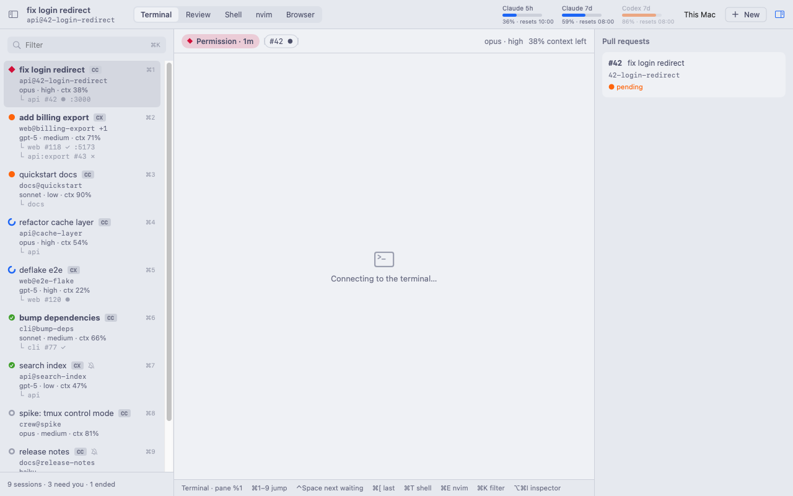
</picture>

crew runs Claude Code and Codex sessions side by side, each in its own git worktree. It tells you which session needs you, shows each change in a local, PR-style review, and removes the worktree when its PR merges. Use it from the native Mac app, the terminal (TUI), or your phone.

## Why crew

- **Parallel agents, no mess.** Each session works in its own worktree. crew attaches each worktree to its session, and removes it when the PR merges. It never deletes a branch, and it backs up uncommitted work first.
- **Review like a PR.** See the last turn, the uncommitted changes or the whole branch. Comment on lines, and send all comments to the agent as one prompt.
- **You step in only when it is necessary.** A session that asks for permission, waits for an answer or finishes goes to the top, with a notification on your Mac or your phone.

## Tour

### Sessions and attention

The sidebar groups sessions by task and shows the state of each one: ◆ permission, ● waiting, ◌ running, ✓ done. The quota bar shows the Claude and Codex limits. Answer a permission prompt from its card.

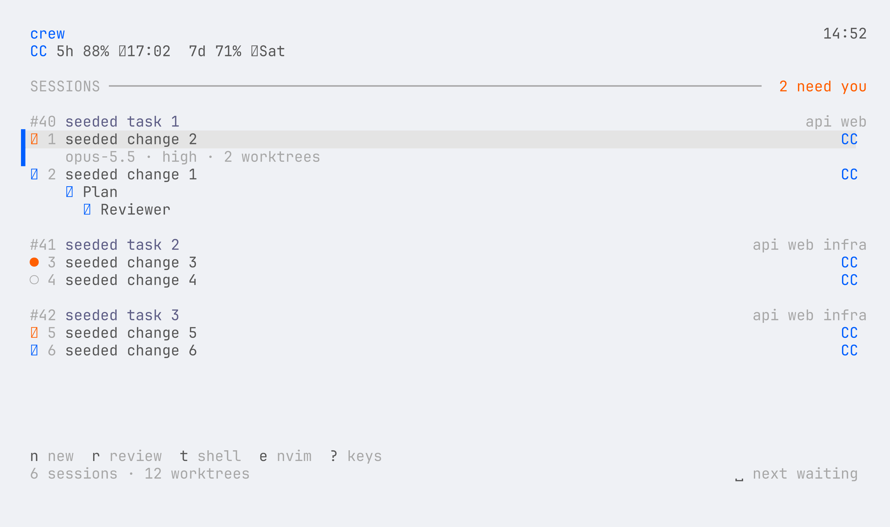

### Review

Read the diff of a session, mark files as viewed, comment on lines, and send the review to the agent. Stage or revert one hunk.

<picture>
  <source media="(prefers-color-scheme: dark)" srcset="docs/images/readme/mac-review-mocha.png">
  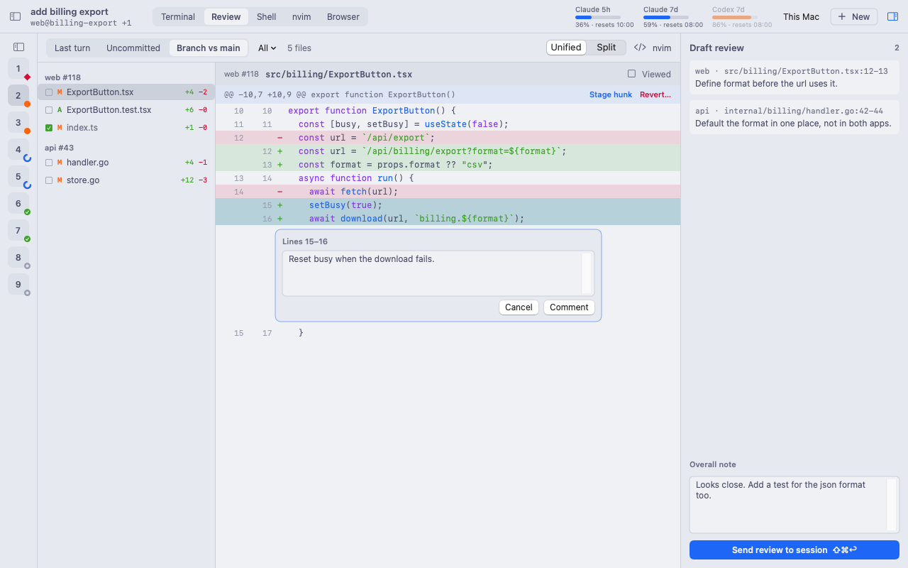
</picture>

### New session

Select a workspace, a task (a PR URL or text, optional), the agent, the model and the effort. crew makes the worktree and runs the setup recipe of the repo.

<picture>
  <source media="(prefers-color-scheme: dark)" srcset="docs/images/readme/mac-new-session-mocha.png">
  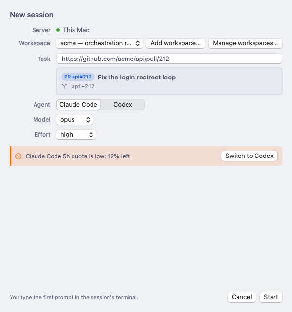
</picture>

### Automations

Define `[[automation]]` tables in `config.toml` or in a repo's `.crew.toml`. Run them by hand with context, on a schedule, or on an event such as a failed CI. See the outcome and history of each run.

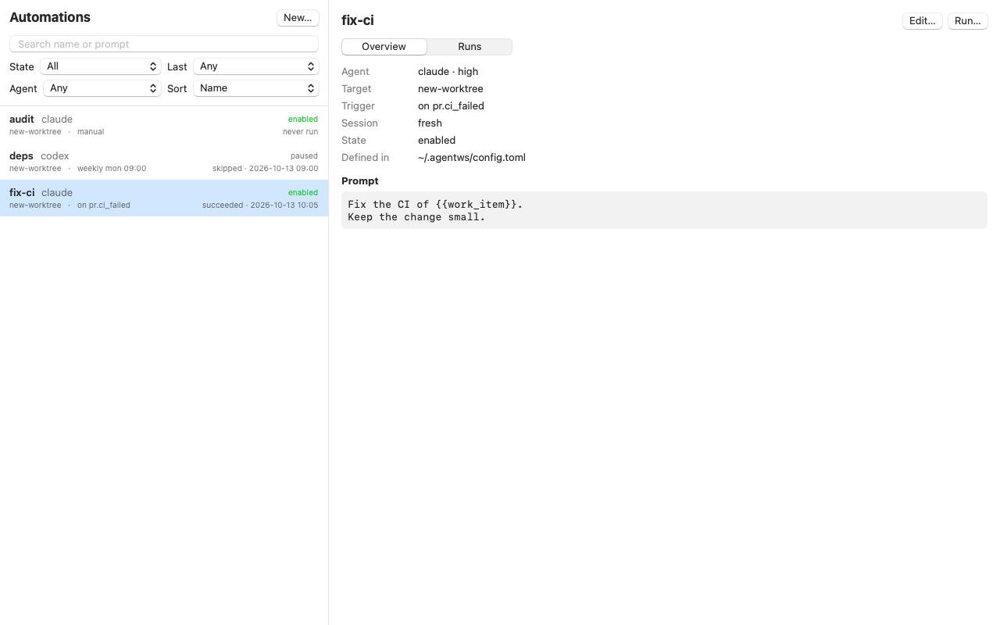

### Browser

The Mac app has a browser for each session. Agents control it with `crew browser`: open the dev server, take a snapshot, click, fill forms and take screenshots.

<picture>
  <source media="(prefers-color-scheme: dark)" srcset="docs/images/readme/mac-browser-mocha.png">
  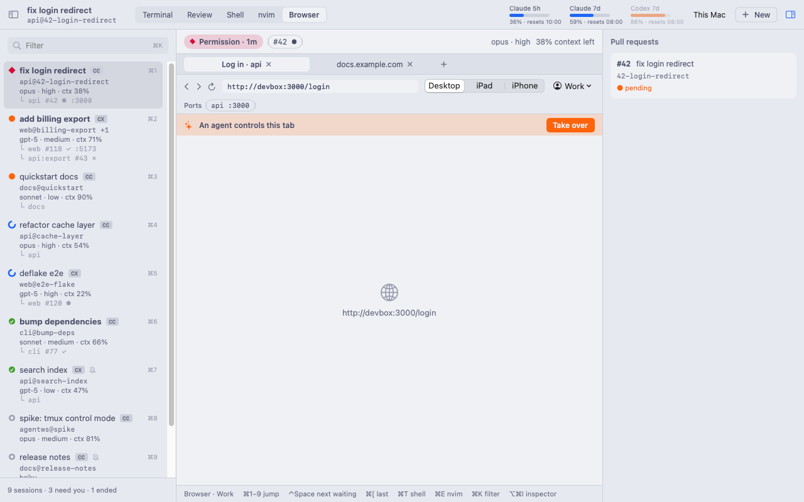
</picture>

When the Mac app is not connected, the daemon can use a headless Chromium on the server. Install Chromium on the server, then set this in `~/.crew/config.toml`:

```toml
[browser]
fallback = "headless"
```

To give the headless browser your logins, run `crew browser cookies import <file>` with a `cookies.txt`, a JSON cookie list or a Playwright `storageState`. See [ADR 0053](docs/adr/0053-headless-browser-fallback.md).

### Phone app

`crew serve` gives a phone app (a PWA): the sessions that need you, a chat view of each session, new sessions, automations and push notifications. See [docs/remote-app.md](docs/remote-app.md).

<p>
  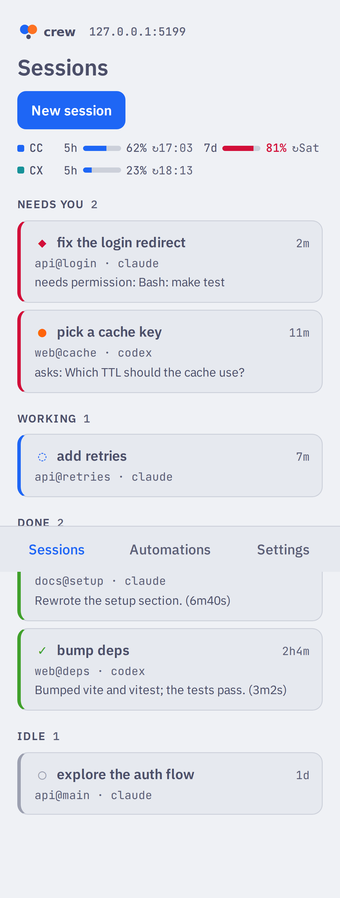
  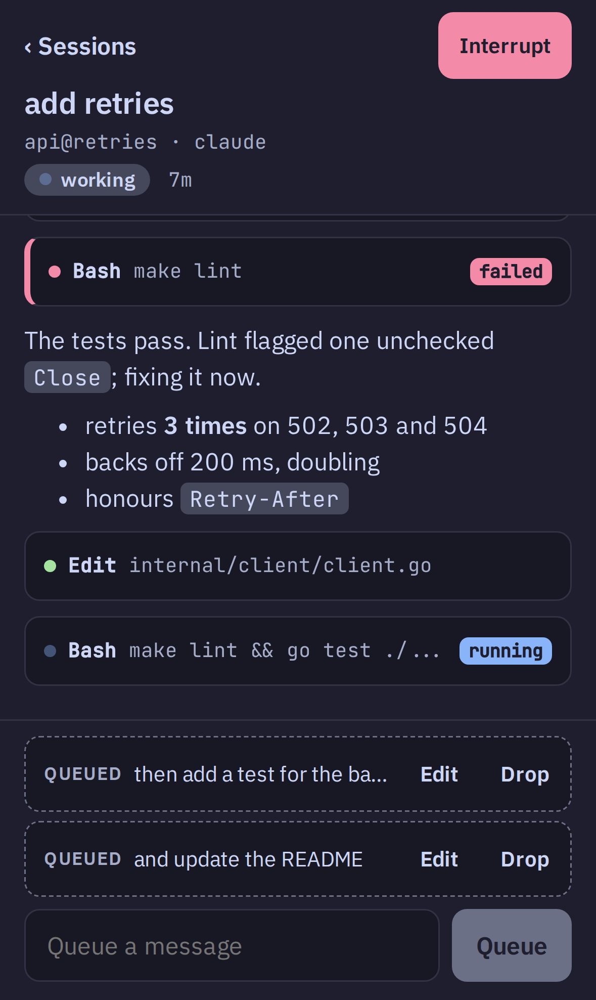
  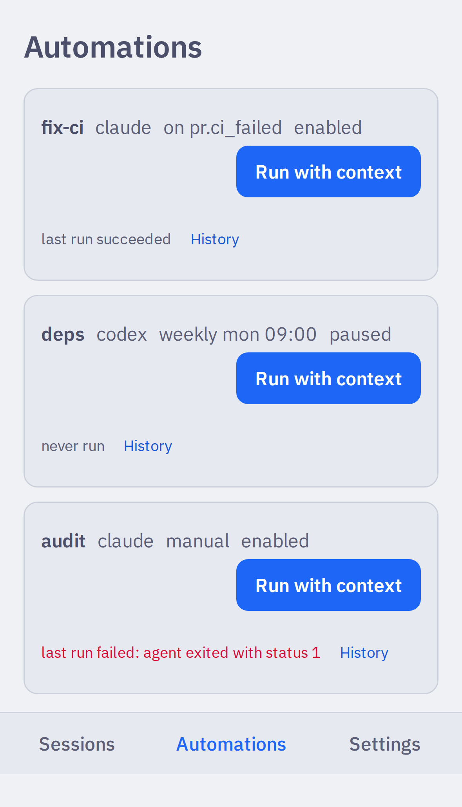
</p>

### Disk and cleanup

See the size and state of each worktree, the dev servers on its ports, and what cleanup will do and when.

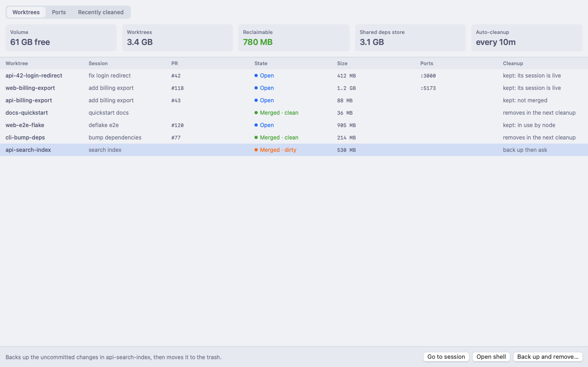

### TUI and nvim

All of crew also works in the terminal. `t` opens a shell in the worktree, `e` opens nvim for the session, and the nvim plugin sends review comments from nvim.

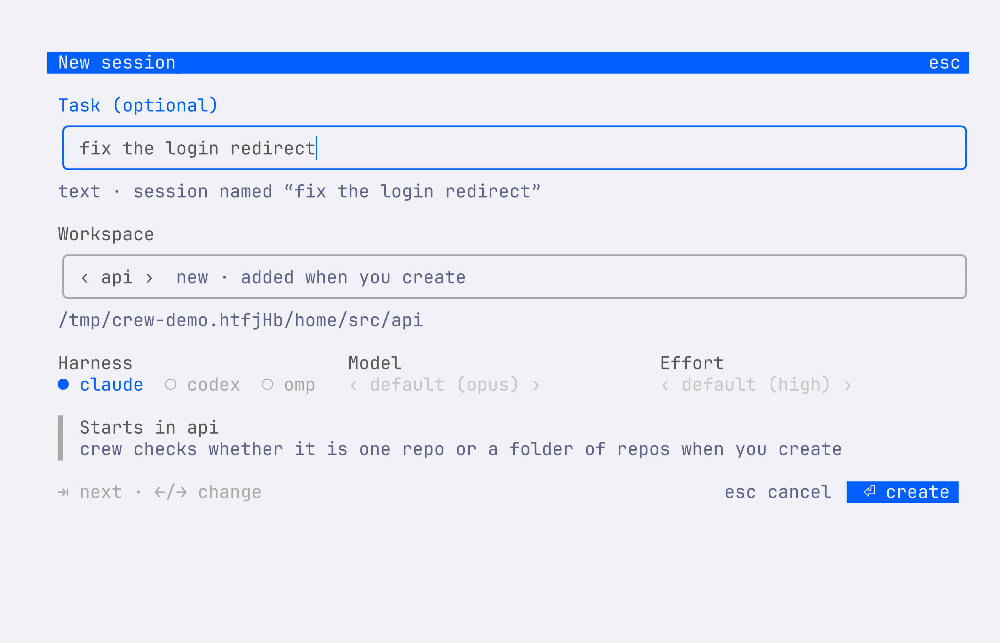

## Install

Builds are available for macOS (arm64, amd64) and Linux (amd64, arm64). You do not need a Go toolchain. You need `tmux`, `git` and the GitHub CLI (`gh`, signed in). You also need Claude Code, the Codex CLI or both.

Optional, on macOS: `brew install terminal-notifier`. If it is on `PATH` when the daemon starts, each session keeps one banner, and a click on a banner shows your terminal on that session. Without it, banners go through `osascript`.

### CLI

Install the newest release:

```sh
curl -fsSL https://raw.githubusercontent.com/giovaniif/crew/main/scripts/install.sh | sh
```

The script does these steps:

1. It downloads the archive for your OS and CPU from GitHub Releases.
2. It checks the archive against `checksums.txt`.
3. It puts the `crew` binary in `~/.local/bin`.
4. It puts the nvim plugin in `~/.local/share/crew/nvim` (`$XDG_DATA_HOME/crew/nvim` if that is set).

Two environment variables change this behavior:

```sh
# a specific release
curl -fsSL https://raw.githubusercontent.com/giovaniif/crew/main/scripts/install.sh | CREW_VERSION=v0.1.0-beta.1 sh
# another directory
curl -fsSL https://raw.githubusercontent.com/giovaniif/crew/main/scripts/install.sh | CREW_INSTALL_DIR="$HOME/bin" sh
```

If the install directory is not on your `PATH`, the script tells you. Add it in your shell profile (`~/.zshrc` or `~/.bashrc`):

```sh
export PATH="$HOME/.local/bin:$PATH"
```

Check the install:

```sh
crew version   # crew v0.1.0-beta.1 (commit abc1234)
```

### Mac app

Each release also has `crew_<version>.dmg`. It is the native Mac app, with the matching `crew` builds in it. Open it and drag `crew.app` to Applications. The app is ad-hoc signed and not notarized, so macOS blocks its first launch. Remove the block one time with this command:

```sh
xattr -dr com.apple.quarantine /Applications/crew.app
```

Or open the app, then go to System Settings › Privacy & Security › Open Anyway.

### Upgrade

`crew version` prints the installed version. At most one time each day, it also checks GitHub for a newer release. To stop this check, set `CREW_NO_UPDATE_CHECK=1`. crew never updates itself. To upgrade, run the install script again. Then stop the old daemon, so that the new binary starts its own daemon:

```sh
curl -fsSL https://raw.githubusercontent.com/giovaniif/crew/main/scripts/install.sh | sh
crew daemon stop
crew
```

### Upgrade from the alphas

The alpha releases had another name. The first start of `crew` (or `crew setup`) moves your state one time, and writes one line for each step:

- The old home dir moves to `~/.crew` (sessions, worktrees, `config.toml` and paired phones), and the old path becomes a link. If both dirs exist, crew uses `~/.crew` and does not change the old dir. If an old daemon still runs, crew does not move the dir and tells you to run `crew daemon stop`.
- Live sessions keep running: the daemon uses the old tmux server until its sessions end.
- The Claude, Codex and omp hooks run `crew hook` after the move. crew backs up each file first.
- `crew setup` replaces the systemd units and launchd agents of the alphas with `crew-*` and `dev.crew.*`.
- The old nvim plugin dir, nvim setup file, browser skill, Claude settings backup and repo config files move to their crew names (`.crew.toml` in a repo). Each old file stays as a `.bak` copy.
- The link with the old command name next to the binary goes away. Scripts that call the old command must call `crew`.
- Environment variables with the old prefix still work as a fallback.
- The Mac app keeps your servers, settings and shortcuts.

## Getting started

Run `crew`. The first time, a setup screen opens on top of the sidebar:

1. **Agents.** Select Claude Code, Codex or both. Each agent shows if its hooks are already set up.
2. **Claude Code.** The screen shows the file that it changes (`~/.claude/settings.json`), what it adds, where the backup goes, and how to undo it (`crew setup claude --remove`).
3. **Codex.** The same for `~/.codex/hooks.json`. Codex then needs a one-time trust step: start `codex` and accept the review prompt for the new hooks.
4. **Neovim (optional).** It writes `~/.config/nvim/plugin/crew.lua`, which loads the plugin. It does not edit your own files.
5. **Done.** Press `⏎` to close the setup screen, then press `n` to start your first session.

To open it again, press `S` in the sidebar or run `crew setup`. `crew setup claude`, `crew setup codex` and `crew setup nvim` do the same installs without the screen. More: [docs/getting-started.md](docs/getting-started.md).

## Requirements

- macOS or Linux, tmux, git and the GitHub CLI (`gh`, signed in).
- Claude Code, the Codex CLI or both.
- For the nvim integration: Neovim 0.10+. For `:CrewDiff`, also [diffview.nvim](https://github.com/sindrets/diffview.nvim).

## Remote app

`crew serve` serves the phone app, and `crew remote pair` pairs a phone with a QR code. **Do not open `serve` to the internet, unless a layer in front of it adds its own authentication.** The setups for Tailscale, a LAN or VPN behind Caddy or nginx, and Cloudflare Tunnel are in [docs/remote-app.md](docs/remote-app.md).

## Codex setup

`crew setup codex` adds the hooks that Codex needs to send state. It also prints the one-time trust step that Codex requires. `crew setup codex --remove` removes the hooks. It backs up an existing `hooks.json` first, and does not change your other hooks.

## Status

crew is in **beta**. Sessions, worktrees and cleanup, review, notifications, the TUI and the Mac app are stable for daily use. Automations, the browser and the phone app are new, and can change. Report a bug or an idea in [GitHub Issues](https://github.com/giovaniif/crew/issues). Include the output of `crew version` and, for the daemon, `~/.crew/daemon.log`.

## Contributing

The build is test-driven, and CI enforces it. Read [AGENTS.md](AGENTS.md) before you open a PR. It covers the layer rules, tests first, no low-value tests or comments, and one PR per issue. Write docs in the style of [docs/style.md](docs/style.md). `make build`, `make test`, `make lint` and `make e2e` are the main commands. `make readme-shots` makes the images of this README.
